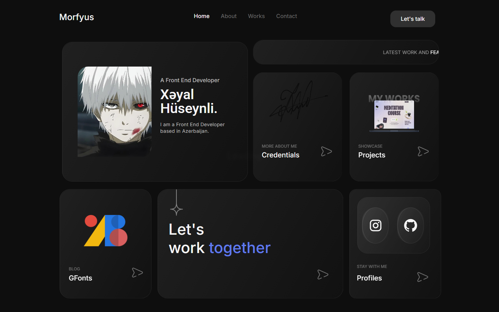
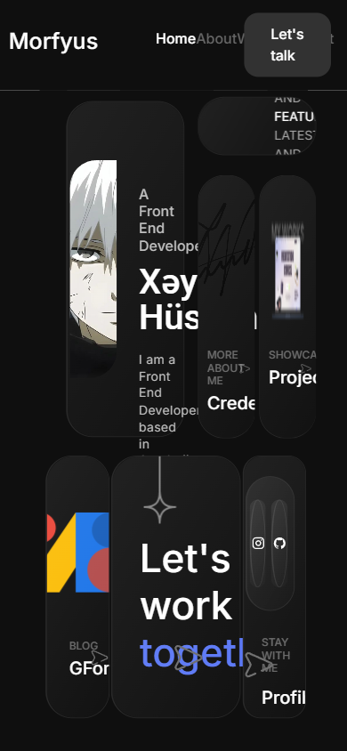

# Portfolio

"Morfyus" — my first multi-page personal site: five HTML pages (home, work, blog, about, contact) on Bootstrap 5.

**Live demo:** <https://portfolio-morpheus2314s-projects.vercel.app>

<p align="center">
<div align="center">

| Desktop | Mobile |
|---|---|
|  |  |

</div>
</p>

## What it does

A 2024 personal site kept public as a baseline: five linked pages sharing one stylesheet and a shared visual shell, with Bootstrap 5 handling the grid and responsive utilities. A vanilla-JS script manages the animated loading screen, a second one drives the blog page, and AOS adds scroll-in animations across every page.

## Tech stack

React 19 · TypeScript · Vite · Bootstrap 5

## Features

- Five linked pages: home, work, blog, about, contact
- Animated loading screen on entry
- AOS scroll-in animations across all pages
- Dedicated blog page with its own script
- One stylesheet per page plus a shared `style.css`

## Run locally

```bash
git clone https://github.com/Mister2314/Portfolio.git
cd Portfolio
npx serve .   # or just open index.html
```

Limitation: each page repeats the header and footer markup — no templating layer, which is the main lesson this project taught me.
