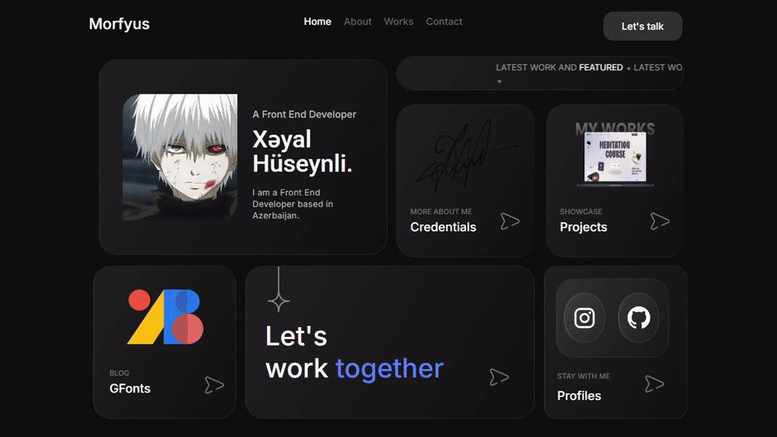
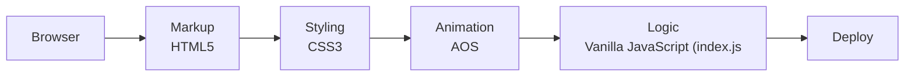

<h1 align="center">Morfyus — Multi-Page Personal Site</h1>

<p align="center"><b>A five-page personal site — home, work, blog, about and contact — built with Bootstrap 5 and scroll animations.</b></p>

<p align="center">
<a href="https://mister2314.github.io/Portfolio/"></a>


</p>

<p align="center"><a href="https://mister2314.github.io/Portfolio/"><b>Live demo</b></a> &nbsp;·&nbsp; <a href="#quick-start">Quick start</a> &nbsp;·&nbsp; <a href="#features">Features</a> &nbsp;·&nbsp; <a href="#architecture">Architecture</a> &nbsp;·&nbsp; <a href="#faq">FAQ</a></p>

<p align="center">
  <a href="https://mister2314.github.io/Portfolio/">
    
  </a>
</p>

<p align="center"><sub>Live capture of the real build — 1705 KB, loops forever.</sub></p>

## Overview

My first attempt at a real multi-page site. Five pages share one header, one footer and one stylesheet, with Bootstrap 5 handling the grid and responsive utilities and a small script managing the loading screen and page behaviour.

It is deliberately kept in the repo as a record of where I started — the layout thinking is here, even if the code is not what I would write now.

## At a glance

| Field | Detail |
| --- | --- |
| **Type** | Static site — no build step |
| **Primary language** | CSS |
| **Live demo** | [mister2314.github.io/Portfolio](https://mister2314.github.io/Portfolio/) |
| **Repository** | [Mister2314/Portfolio](https://github.com/Mister2314/Portfolio) |

## Features

- Five linked pages: home, work, blog, about, contact
- Bootstrap 5 grid and responsive utilities
- Animated loading screen on entry
- AOS scroll-in animations across all pages
- Blog listing with a dedicated blog script
- Shared header, footer and navigation across pages

## Tech Stack

| Layer | Technology |
| --- | --- |
| Markup | HTML5, five pages |
| Styling | CSS3, Bootstrap 5.3 |
| Animation | AOS |
| Logic | Vanilla JavaScript (`index.js`, `blog.js`) |
| Deploy | GitHub Pages |

## Architecture



## Screenshots

| Desktop | Mobile |
| :---: | :---: |
|  |  |

## Quick Start

```bash
git clone https://github.com/Mister2314/Portfolio.git
cd Portfolio

# open it directly
start index.html      # Windows
open  index.html      # macOS

# or serve the folder
npx serve .
```

## Project Structure

```
index.html — home page
work.html / blog.html / moreabout.html / contact.html — remaining pages
assets/css/ — one stylesheet per page plus a shared style.css
assets/js/index.js — shared behaviour and loading screen
assets/js/blog.js — blog page logic
```

## FAQ

<details>
<summary><b>Is this the current portfolio?</b></summary>

No. This is my first multi-page site, kept public as a baseline. The current work is **Khayal Verse** and **Hypnos.dev**.

</details>

<details>
<summary><b>Why Bootstrap?</b></summary>

It was the fastest way to learn responsive layout at the time. I would write the grid by hand now — that is what the newer projects do.

</details>

<details>
<summary><b>How do the pages share a header and footer?</b></summary>

They do not, technically — each page repeats the markup. A build step or a templating layer would remove the duplication, and that is exactly the lesson this project taught me.

</details>

## Roadmap

- [ ] Archive it and redirect to the current portfolio
- [ ] Note in the header that it is a 2024 build

## Notes

Kept public on purpose. It is the earliest thing here, and comparing it with the newer repositories is a fair measure of how much changed.

## Author

**Xəyal Hüseynli** — Junior Front-End Developer

[Portfolio](https://hypnosdev.vercel.app) · [GitHub](https://github.com/Mister2314) · [LinkedIn](https://www.linkedin.com/in/x%C9%99yal-h%C3%BCseynli-3487b91ba/) · [xeyalhuseynli06@gmail.com](mailto:xeyalhuseynli06@gmail.com)
